# Future Flutter 컨퍼런스 톺아보기

## 소개

조금 늦었지만, 2024년 9월 28일 진행된 Flutter 컨퍼런스 Future Flutter에서 들었던 내용을 정리하고, 실제 회사에 적용해보며 겪었던 이슈들에 대한 내용을 정리한 글이다.

<aside class="callout info">

<strong>목차</strong>


1. [FFI로 연결하는 고(Go)와 플러터](#ffi로-연결하는-고go와-플러터)
2. [Flutter WebRTC](#flutter-webrtc)
3. [ShoreBird 작동 방식](#shorebird-작동-방식)
4. [풍성한 디자인 요청사항에 대응하기](#풍성한-디자인-요청사항에-대응하기)
5. [플러터 렌더링 해부학](#플러터-렌더링-해부학)
6. [Flutter web을 활용하여 제품 개발 환경 개선하기](#flutter-web을-활용하여-제품-개발-환경-개선하기)
7. [어느날 갑자기 앱이 터졌을 때](#어느날-갑자기-앱이-터졌을-때)
8. [Flutter Bloc을 제품 개발에 야무지게 적용하기](#flutter-bloc을-제품-개발에-야무지게-적용하기)


</aside>


<!--truncate-->

## FFI로 연결하는 고(Go)와 플러터

멀티 플랫폼에 대응하는 앱을 만들기 위해 Go 언어와 플러터를 활용하며 기본적인 UI 디자인을 적용하며 고성능의 앱을 개발하는 방법에 대해 고민하며 적용한 내용에 대한 발표였다.

### 왜 Go 인가?

고언어를 채택한 장점에는 크게 3가지의 이유가 있었다.

#### 크로스 플랫폼 개발

Windows, macOS, Linux 와 같은 다양한 운영체제와 x86, ARM 등의 아키텍쳐로 크로스 컴파일이 가능하여 보다 빠르게 다양한 플랫폼 지원을 간편하게 한다.

#### 빠른 컴파일과 실행

Go언어는 머신코드로 바로 컴파일 가능하기 때문에 고성능의 앱 개발에 유리하다. 실행속도가 빠를 뿐만아니라 컴파일 속도도 빨라, 수정사항을 빠르게 적용하여 테스트 가능하고 이로인해 개발 속도를 빠르게 가져갈 수 있다.

#### 가벼움과 확장성

고루틴과 채널이라 알려진 동시성 기능을 지원하여 많은 작업들을 성능저하 없이 동시에 처리 가능하다. 효율성과 확장성을 필요로하는 고성능 어플리케이션 개발에 이상적이다.

### 왜 플러터인가?

#### 크로스 플랫폼 개발

하나의 코드 베이스로 안드로이드, IOS, Windows desktop, Web 등 여러 플랫폼 개발이 가능하다. 이로인해 적은 인원과 시간으로 다양한 플랫폼에 대응하는 App.을 개발할 수 있다.

#### 유용한 개발도구

플러터의 핫리로드, 핫리스타스 같은 기능과 유용한 개발 도구를 지원해 개발 속도를 빠르게 한다.

#### 빠르고 아름다운 애플리케이션

플러터는 자체적으로 기본적인 애니메이션과 인터렉션에 대한 처리가 되어있어 보다 간편하게 고퀄리티의 사용자 경험을 제공한다. 또한 각 플랫폼에 맞게 컴파일되어 효율적으로 동작하도록 해준다.

### FFI 란?

Foreign Function Interface (FFI)는 C언어로 짜여진 함수를 다트나 플러터에서 사용하는 방법으로 플러터에서는 `dart:ffi` 패키지를 사용한다.

C뿐만 아니라 Go, C++, Rust 등의 **C 인터페이스를 제공하는 언어**라면 Dart에서 사용이 가능하다.

### 플러터에서 FFI 사용하기

```bash
flutter create --platforms=android,ios,macos,windows,linux --template=plugin ffi native add
```

위 커맨드로 프로젝트를 생성하면 `lib`폴더 아래에 `Dart` 코드, `src` 폴더 아래에 `C` 코드가 생성된다.

#### 고언어 라이브러리 생성하기

##### 고언어 코드 작성

1. `src`폴더 안에 `go.mod` 파일 생성

   > **`go.mod` 파일이란?** 모듈 이름, 버전, 의존성 등을 정의하는 파일

2. `sum.go` 파일을 생성하고 고언어 코드를 작성

   ```go
   // sum.go file
   package main

   import "C"          // cgo 문법으로
                       // export <함수명> 주석을 이용해서 sum이라는 함수를 C로 export

   // export sum
   func sum(a C.int, b C.int) C.int {      // C에서 사용해야하기 때문에 Go의
       return a + b                        // 타입이 아닌 C 타입으로 C.int 를 사용
   }

   func main() {}
   ```

#### 고언어 라이브러리를 안드로이드용으로 컴파일

최신 안드로이드 단말기들을 지원하기 위해서는 `arm64`와 `x86_64` 아키텍처를 지원하도록 크로스 컴파일 되어야함

```bash
export ANDROID_OUT=../android/src/main/jniLibs
export ANDROID_SDK=$HOME/Library/Android/sdk
export NDK_BIN=$ANDROID_SDK/ndk/23.1.777.9620/toolchains/llvm/prebuilt/darwin-x86_64/bin

# x86_64 아키텍처로 컴파일 해서 android/src/main/jniLibs/x86_64 폴더에 libsum.so 생성
CGO_ENABLED=1 \
GOOS=android \
GOARCH=and64 \
CC=$NDK_BIN/x86_64-linux-android21-clang \
go build -buildmod=c-shared -o $ANDROID_OUT/x86_64/libsum.so

# arm64 아키텍처로 컴파일 해서 android/src/main/jniLibs/arm64-v8a 폴더에 libsum.so 생성
CGO_ENABLED=1 \
GOOS=android \
GOARCH=arm64 \
CC=$NDK_BIN/aarch64-linux-android21-clang \
go build -buildmode=c-shared -o $ANDROID_OUT/arm64-v8a/libsum.so
```

#### 고언어 라이브러리를 IOS용으로 컴파일

기본적인 컨셉은 안드로이드용 빌드와 동일하나 약간의 추가과정이 필요함

- IOS는 static 라이브러리로 컴파일 해야함
- 시뮬레이터용 `arm64`와 *`arm64` 빌드*와 _아이폰용 `arm64` 빌드_, 총 세개의 라이브러리로 컴파일
- 시뮬레이터용 라이브러리 두개를 통합하기 위해 lipo라는 도구를 사용
- 빌드된 모든 라이브러리를 `xframework`패키지로 통합

### 플러터에서 사용하기

#### FFIgen을 사용해서 바인딩 만들기

`C`라이브러리를 `Dart` 코드에서 사용할 수 있게 하는 바인딩을 `ffigen`이라는 도구를 이용해서 자동생성. `ffigen`을 돌리기 위해 `ffigen yaml` 작성

```yaml
# Run with `flutter pub run ffigen --config ffigen.yaml`.
name: NativeLibrary
description: Bindings to `src/sum.h`.
output: `lib/generated_bindings.dart`
headers:
  entry-points:
    -`src/libsum.h`
preamble: |
  // ignore_for_file: always_specify_types
  // ignore_for_file: camel_case_types
  // ignore_for_file: non_constant_identifier_names
  // ignore_for_file: unused_field
  // ignore_for_file: unused_element
comments:
  style: any
  lenght: full
```

#### 다트코드에서 사용하기

이제 라이브러리를 다트에서 로드하고 `generated_bindings.dart` 파일에 `C` 함수로 바인딩된 다트 함수를 호출 가능

```dart
// lib/native_add.dart
import 'dart:ffi';
import 'dart:io';
import 'generated_bindings.dart';

int sum(int a, int b) => _bindings.sum(a, b);

const String _libName = 'native_add';

/// The dynamic library in which the symbols for {NativeAddBindings} can be found.
final DynamicLibrary _dylib = () {
  if (Platform.isAndroid || Platform.isLinux) {
    return DynamicLibrary.open('libsum.so');
  }
  throw UnsupportedError('Unknown platform: ${Platform.operatingSystem}');
}();

/// The bindings to the native functions in [_dylib].
final NativeLibrary _bindings = NativeLibrary(_dylib);
```

### 정리

- `C` 인터페이스를 제공하는 언어라면 `Dart`에서 **FFI**를 통해 사용 가능함
- `ffigen`을 이용하면 `.h`를 읽어 자동으로 바인딩 코드를 생성해줌
- `Go` 언어의 크로스 컴파일러를 이용해 쉽게 크로스 플랫폼 라이브러리 생성 가능

<aside class="callout info">

<strong>Next Step</strong>


- IOS / macOS / Windows / Linux 등 안드로이드 외 다른 플랫폼 빌드
  - 예시는 Android / IOS / macOS 까지만 동작
- 웹에서도 동작하도록 빌드 (힌트: WebAssembly)
- 메모리 공유나 비동기 처리등의 고급 사용예제

</aside>

## Flutter WebRTC

Flutter에서 WebRTC를 어떻게 다루는지에 대한 내용을 기대하였지만, 기대했던 내용과는 달리 단순히 WebRTC에 대한 설명만 진행하였다. WebRTC에 대해 잘 알지 못하여 이 내용 또한 유익한 시간이었다.

### 서론

발표자분께서 현재 회사에 영상통화 솔루션을 개발하며 얻은 Flutter WebRTC 지식을 공유해주셨다. WebRTC에 대한 기본 개념과 Flutter 환경에서 WebRTC로 화상 통화를 어떻게 구현하였는지를 공유해주셨다.

### WebRTC의 주요 개념

WebRTC의 **RTC**는 **Real-Time Communication**의 약자이다. 웹 애플리케이션과 사이트가 **중간자 없이** 브라우저간에 **오디오/비디오 스트리밍** 및 데이터 교환을 가능하도록 하는 기술이다.

웹에서 실시간 미디어 스트리밍을 하기위한 **유일한 표준**으로 2010년 Google에 의해 오픈소스화 되었다. 이후 Chrome 등 **모든 브라우저**에 탑재 되었다. (물론 IE에서는 제외 되었지만, IE는 이제 보내주도록 하자 😭) Flutter에서 사용하는 WebRTC도 당연히 동일한 원리로 실행된다.

클라이언트 간의 **직접 연결**로 구현 가능하지만, 클라이언트들이 완전히 같은 네트워크에 있는게 아닌 이상 직접 연결하는 것은 어렵다. 따라서 **시그널링 서버**와 **릴레이 서버** 같은 기술들이 생겨난다.

#### 시그널링(Signaling) 서버

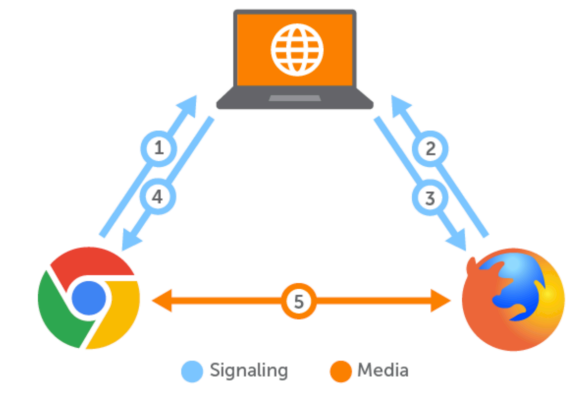

각각의 기기가 **서버의 도움 없이 연결**하는 것을 도와주는 서버로, 뒤에서 다룰 **SDP(Session Description Protocol)** 교환에 관련된 서버이다. 실제 데이터가 시그널링 서버를 통해서 오가는 것이 아니라는 점을 유의하자.

#### 릴레이(Relay) 서버

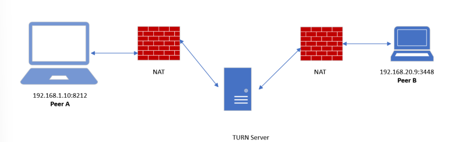

**TURN 서버**라고도 부른다. 방화벽이나 여러 제약으로 인해 **P2P** 연결이 불가능한 상황에서 **클라이언트 간 중계**를 해주는 서버이다. 구글은 개발자들을 위해 **TURN 서버 코드**를 제공하고 있다. TURN 서버를 구현해 놓으면 서로 다른 네트워크에 있어도 P2P처럼 통신이 가능하다.

#### STUN 서버

**STUN 서버**는 **TURN 서버**와 혼동하기 쉽다. **STUN 서버** 는 **Session Traversal Utilities for NAT**의 약자로 통신을 위해 **자기 자신의 정보**를 알아내기 위한 서버이다. 예를 들어, 공유기를 사용하는 환경에서 외부IP를 알아내기 위해 사용된다. 자기 자신을 비추는 거울로 생각하면 된다.

#### RTCPeerConnection 객체

WebRTC를 위해 제공되는 Web API 객체이다. 웹 브라우저 또는 네이티브 앱에서 직접적인 통신 연결을 생성 및 관리하고, 데이터 스트림을 교환하는 역할을 수행한다. 이를 잘 이해하고 활용한다면 WebRTC 구현을 위해 개발자가 할 일이 크게 줄어들 것이다.

**RTCPeerConnection**이 하는 역할은 다음과 같다

- offer, answer, ice-candidate 등 WebRTC를 위한 **신호처리**
- STUN 및 TURN 서버를 사용한 **NAT 및 방화벽 통과**
- 사용자의 디바이스(카메라, 마이크)에서 오는 **미디어 스트림 관리**
- 클라이언트 간 데이터를 직접 교환하기 위한 **데이터 채널 생성**
- 통신 세션이 초기화 되거나 변경될 때 **세션 협상** 및 **재협상**
- 모든 통신을 자동으로 암호화하여 **중간자 공격**으로부터 보호
- 통계 및 네트워크 정보 제공

WebRTC의 경우 Flutter만을 위한 자료가 거의 없으므로 [MDN 사이트](https://developer.mozilla.org/en-US/docs/Web/API/RTCPeerConnection)를 통해 확인하는 것이 좋다.

#### SDP (Session Description Protocol)

발신자와 수신자는 모두 **클라이언트**이므로 통신 환경이 다른 경우가 대부분이다. 따라서 SDP를 통해 서로의 **미디어 능력** 및 **연결 정보**를 공유해야 한다.

SDP에는 오디오 및 비디오 코덱, 미디어 스트림의 방향, RTP(Real-time Transport Protocol) 엔드포인트 정보가 포함된다.

#### ICE (Interactive Connectivity Establishment)

일반적으로 발신자와 수신자는 **서로 다른 네트워크**를 사용하게 된다. 하지만 발신자에서 수신자로, 수신자에서 발신자로 가는 네트워크 경로는 다양하므로 다른 네트워크에 속한 클라이언트 간 통신 구현은 어렵다. ICE는 발신자 또는 수신자 입장에서 **내게 오는 길**을 알려준다.

ICE Candidate는 다음 내용을 포함한다. IP 주소, 포트 번호, 프로토콜(UDP 또는 TCP), Candidate 유형(host, srflx, prflx, relay 등 포함)

각 피어는 **자신의 모든 후보를 수집**한 후 이를 다른 피어와 교환한다. 양쪽 피어는 **가능한 모든 후보 조합**에 대해 연결성 검사를 수행하며 **가장 높은 우선순위**를 가진 후보 조합이 선택되어 미디어 통신에 사용된다.

#### WebSocket

WebRTC에서 WebSocket이 반드시 필요하지는 않지만, **실시간 양방향 통신**에서의 이점 때문에 많이 활용된다.

### WebRTC 관련 Flutter 패키지

#### flutter_webrtc

Flutter에서 WebRTC 기능을 이용하기 위한 패키지로 기본적으로는 iOS, Android 등 다양한 플랫폼을 위해 제공되는 WebRTC 공식 **네이티브 패키지**를 **메서드 채널**로 묶어 놓은 구조이다.

#### web_socket_channel

Dart/Flutter에서 WebSocket 관련 기능을 제공한다. Web API에 비해 아직은 일부 기능을 지원하지 못하는 등 조금 미흡하다.

#### flutter_callkeep

Flutter에서 전화 수신 및 발신 UI를 처리하는 기능을 제공해준다. iOS는 CallKit을 사용하며, Android는 자체 UI를 띄워준다. iOS CallKit 구현을 위해서는 별도로 VoIP Push 구현이 필요하다

### WebRTC & WebSocket 동작흐름

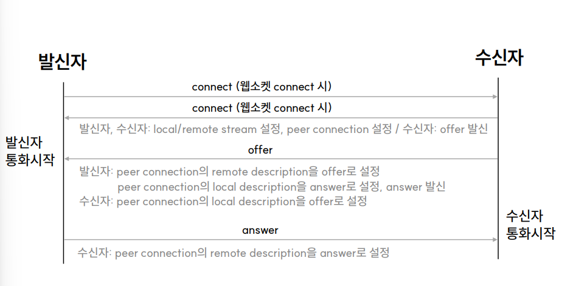

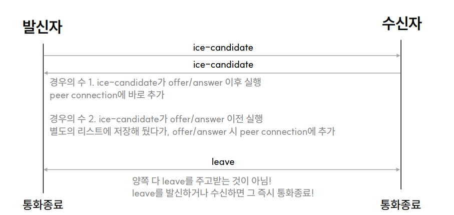

WebSocket이 연결되면 WebSocket을 통해 connect 데이터가 전송된다. (발신자, 수신자 모두)

```json
{
  "type": "connect",
  "callId": "string"
}
```

connect 수신 시 발신자와 수신자는 다음 동작을 수행한다.

1. RTCPeerConnection 객체 초기화
2. onIceCandidate 이벤트 리스너 추가(ice-candidate 전송)
3. onAddStream 이벤트 리스너 추가(Remote Stream 초기화, Remote Renderer를 Remote Stream과 연결, Local Renderer를 Local Stream 과 연결)
4. Local Stream 초기화
5. 수신자는 offer 생성 및 발신

offer와 answer는 **SDP**를 교환하기 위해 이루어진다.

#### offer

수신자는 connect를 받으면 offer를 보낸다.

```json
{
  "type": "offer",
  "sdp": "string",
  "callID": "string",
  "restart": "boolean"
}
```

#### answer

발신자는 offer를 받았을 때 answer를 보낸다.

```json
{
  "type": "answer",
  "sdp": "string",
  "callId": "string"
}
```

- 수신자의 offer 발신 동작

  1. offer 생성
  2. RTCPearConnection 객체를 다음과 같이 설정 - Local Description: offer
  3. 발신자에게 offer 전송

- 발신자의 offer 수신 & answer 발신 동작

  1. RTCPeerConnection 객체를 다음과 같이 설정 - Remote Description: offer
  2. sdp 기반 answer 생성
  3. RTCPeerConnection 객체를 다음과 같이 설정 - Local Description: answer
  4. 수신자에게 answer 전송
  5. 통화 시작을 위한 UI 처리

- 수신자의 answer 수신 동작
  1. RTCPeerConnection 객체를 다음과 같이 설정 - Remote Description: answer
  2. 통화 시작을 위한 UI 처리

#### ice-candidate

ICE Candidate를 수신하고 RTCPeerConnection 객체에 ICE Candidate를 **모두 추가**

```json
{
  "type": "ice-candidate",
  "candidate": {
    "candidate": "string",
    "sdpMid": "string",
    "sdpMLineIndex": "int"
  },
  "callId": "string"
}
```

offer-answer 교환이 끝나기 전에 ICE Candidate 교환이 먼저 일어나는 경우도 있다. 이때는 **별도의 리스트**에 ICE Candidate를 모두 저장해 뒀다가 offer-answer가 발생 했을 때 **Peer Connection**에 ICE Candidate를 추가해주면 된다.

#### leave

통화를 종료하기 위해 이루어진다. 수신자와 발신자 중 어느 한 쪽이 leaave를 전송하면 즉시 **통화 종료** 된다.(서로 leave를 교환할 필요가 없다.)

```json
{
  "type": "leave",
  "callId": "string"
}
```

### Flutter WebRTC를 위한 팁

#### 수신자의 응답 이전 발신자의 통화 종료

서버에서 수신자에게 `"HUNGUP"` Push 알림을 보내 전화 수신 화면, 소리, 진동이 뜨지 않도록 해야한다.

#### 수신자의 통화 거절

서버에서 발신자에게 `"REJECTED"` Push 알림을 보내 video 화면에서 빠져나오도록 한다.

#### 수신자가 여러 기기 중 하나의 기기에서 응답

서버에서 수신자의 다른 기기들에 `"RESPONDED"` Push 알림을 보내 전화 수신 화면, 소리, 진동이 뜨지 않도록 해야한다.

#### 통화 종료

통화 종료 시에는, 한쪽이 `"leave"` 메시지를 상대편에 보내면 둘다 종료된다.
하지만 여러가지 이유로 이 동작이 정상적으로 진행되지 못하는 경우가 있는데, 이때는 signaling 서버에서 `"leave"` 메시지를 디바이스에 보내서 종료하도록 한다.

## ShoreBird 작동 방식

멀티 플랫폼 모바일 애플리케이션 개발을 위해 많이 사용되는 프레임워크 하면 ReactNative, Flutter 와 같은 프레임워크들이 생각날 것이다. RN(ReactNative) 하면 여러 기능중 단연 **Code Push** 를 먼저 떠올릴 수 있는데, `Flutter` 에서 `Code push` 를 적용하기 위해 만들어진 서비스인 `Shorebird`에 대해 알아보자.

### Code push란?

- 코드 수정 시 디바이스에서 업데이트를 하지 않아도 지속적으로 사용자가 변경사항을 가져올 수 있다
- 대부분의 큰 애플리케이션들은 `Code push`를 사용중이다.

  - _Large install base = long store update time_ 이므로

- 비즈니스에서 현실적인 문제들
  - Downtime = lost revenue
  - Code push = insurance you can fix things quickly if they go wrong

## 풍성한 디자인 요청사항에 대응하기

LINE 2년차 주니어 개발자로 일하면서 플러터를 사용하여 여러 디자인 요구사항들을 해결한 경험들을 공유한 시간이었다.

### CustomPaint를 활용한 Container

다양한 모양의 컨테이너를 생성하기 위해 CustomPaint를 사용하여 오각형의 도형을 만들며 동적으로 수정할 수 있도록 변경한 방법들에 대해 공유해주셨다.

`CustomPaint` 의 경우 Flutter 에서 매우 중요하게 활용된다. 특히 Interactive 한 화면을 디자인하기 위해 Animation 효과를 적용할 때 Svg 파일을 CustomPaint로 변환하면서 특히 많이 활용이 되는데, 현재 회사에서 apple의 [SF Symbols](https://developer.apple.com/sf-symbols/)와 유사하게 아이콘들을 커스텀 가능하게 수정하는 작업을 하며 보고있던 부분이라 반가운 주제였다.

발표내용은 간단한 path 를 생성하는 방법을 공유해주는 조금 쉬운 내용이었지만, `Flutter`를 처음 접하며 겪었던 고민들과 같은 고민을 해봤던 개발자 동료를 만나 반가웠다.

추가로 `CustomPaint` 의 경우 `Flutter` 팀에서 `SVG` 를 대체하기 위해 최적화를 신경써서 좋은 성능으로 화면에 아이콘이나 벡터이미지를 생성할 수 있게 해주었는데, 이와 관련하여 [Youtube](https://www.youtube.com/watch?v=w9lD35D78N8)에서 설명한 내용도 참고하자

### Loading Skeleton

최근 로딩화면을 단순히 Circular Loader로 구현하지 않고 사용자로 하여금 어떤 자료들이 보여질지 예측이 가능하도록 디자인하는 Skeleton Design을 많이 적용하고 있는 것으로 알고있다. 현재 회사에서도 이러한 점 때문에 팀원분들과 디자이너분께 강력하게 어필하여 Loading Skeleton을 모두 적용하였었는데, 마찬가지로 적용했던 내용과 같은 것을 듣게되어 놀랐다.

발표 내용은 두개의 컨테이너를 교차하여 빛반사가 움직이는 효과를 적용한 과정에 대해 간략하게 설명해 주셨고 `Shimmer` 라는 Package를 사용하면 보다 간편하게 적용할 수 있음을 공유해주셨다.

하지만, 두개의 컨테이너를 교차하지 않아도 CustomPaint를 활용하면 같은 효과를 낼 수 있다. Gradient 범위를 설정해주면 범위 밖의 색상은 가장 바깥에 설정해준 색상으로 표시되기 때문에 동일한 효과를 낼 수 있다.

### CustomScrollView + Dropdown

마지막 발표내용까지도 이전에 Help 페이지를 적용하며 구현했던 Scroller 의 위치를 가져와 UI에 적용하는, 이번 회사에 들어오고 한달동안 뜯어 고쳤던 UI들에 대한 내용들이 모두 나와서 깜짝 놀랐다.. 역시 어느회사나 하는 일들은 비슷한 것 같다.

발표자분의 경우 화면 스크롤 시 CustomScrollView 위에 표시해준 Overlay가 화면이 스크롤될 때 같이 올라가는 문제가 있었고 이를 Scrollbar offset을 가져와 높이를 계속 추가해주어 해결한 내용에 대해 공유해 주었다.

이 부분에 있어서도 `Flutter` 의 Overlay 위젯을 활용하면 `Main` 위젯을 부모요소로 가지므로 해결가능한 문제였지만, 스크롤바의 offset을 가져와서 다양한 Interaction을 구현하는 방식은 많이 활용되므로 어떻게 코드를 작성하였는지 흥미롭게 들었다.

### 디자이너와 소통하기

디자이너분들과 메신저를 통해서 소통한 방법들과 내용들에 대해 공유해주셨다. 명확하게 의견을 주고받을 수 있도록 다양한 방법을 제공해주셨는데 해당 방법들은 다음과 같다.

- 내가 이해한 바를 정확하게 공유하기
- 질문할 때는 이해가 쉽게 시각 자료를 첨부하기
- 선택이 필요할 때는 가능한 옵션을 먼저 제공하기
- 디자이너의 의도와 동일하게 구현하기 위해 최선을 다하기

## 플러터 렌더링 해부학

Flutter Seoul의 오거나이저로 활동 중이신 에이든님의 발표로 플로터 위젯이 화면에 표시될 때 어떠한 방식으로 렌더링이 되는지, Dart 코드를 뜯어보며 확인해보도록 자료를 준비해주셨다. 에이든님의 경우 Flutter 월간 세미나에서도 Flutter Web의 Image 렌더링에 대한 발표를 들었었는데, 두 내용 모두 찾아보기 귀찮고 생각만해도 피곤한 내용들을 꼼꼼히 잘 설명해주셔서 많은 도움이 되었다.

### 랜더링 과정

#### Widget

위젯은 플러터를 시작할 때 가장 먼저 접하는 클래스이자, 개발 과정에서 가장 자주 사용하는 클래스이다. 플러터 개발자에게 있어 위젯은 앱 개발의 가장 핵심적인 요소라고 할 수 있을 것이다.

플러터 공식 문서를 보면 **Widget**은 `"Describes the configuration for an Element"` "Widget은 Element의 구성을 표현하는 객체" 라고 설명한다. 하지만 플러터 개발자들 사이에 위젯에 대한 설명으로 이보다 더 널리 알려진 설명이 있는데 바로 `"In Flutter, almost everything is a widget"`이다. 여기서 흥미로운 점은 `'almost everything'` '거의 모든 것'이라는 표현인데 위젯을 **'거의 모든 것'**이라 설명하는 이유는 무엇일까? 또 그렇다면 거의 모든 것에 포함되지 않는 것들은 어떤 것들이 있을까

**'Almost everything'**인 Widget 너머, 화면을 그리는 자세한 과정을 살펴보며 이를 알아보자

#### ColoredBox

화면에 색을 칠하는 간단한 프로젝트를 구현하려 한다. 색을 칠하는데 흔히 사용되는 `Container`가 아닌 `ColoredBox`위젯을 사용하여 이를 구현해보자.

아래는 `ColoredBox` 위젯을 이용해 사각형의 Box 공간을 녹색으로 칠하는 간단한 코드이다. 렌더링 과정을 살펴보기 위해 `MaterialApp`이나 `Scafford`를 사용하지 않고 위젯트리를 간단히 구성하였다.

```dart title="ColoredBox"
import 'package:flutter/material.dart';

void main() {
  runApp(
    const ColoredBox(
      color: Colors.green,
    ),
  );
}
```

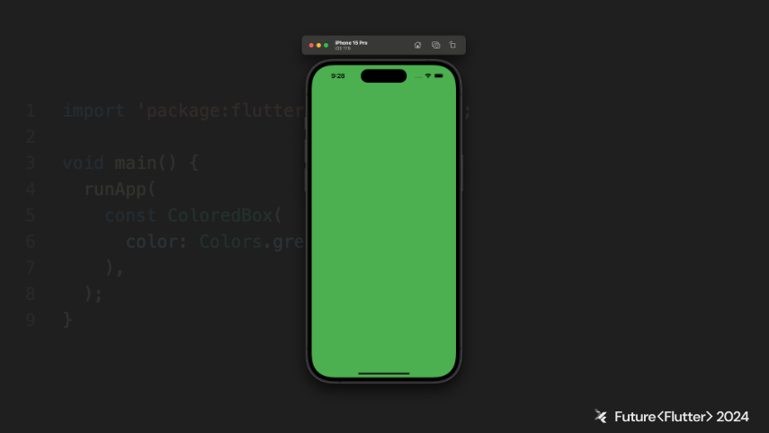

ColoredBox 위젯의 생성자로 녹색을 전달했기 때문에 실행하면 녹색으로 가득찬 화면을 볼 수 있을 것이다.

widget에 대한 설명을 다시 한번 떠올려보자 `"Describes the configuration for an Element"`, Widget은 Element의 구성을 표현하는 객체일 뿐이다.

다음으로 Widget인 ColoredBox가 Element를 어떻게 구성하는지, ColoredBox를 뜯어보며 확인해보자

```dart title="ColoredBox"
class ColoredBox extends SingleChildrenderObjectWidget {
  @override
  RenderObject createRenderObject(BuildContext context) => _RenderColoredBox(color: color);
}

abstract class SingleChildRenderObjectWidget extends RenderObjectWidget {
  @override
  SingleChildRenderObjectElement createElement() => SingleChildRenderObjectElement(this);
}

abstract class RenderObjectWidget extends Widget {
}
```

위 코드를 통해 `ColoredBox` 위젯을 확인해보면 `ColoredBox` 위젯은 `SingleChildRenderObjectWidget`을 확장하고 있다. 또 `SingleChildRenderObjectWidget`은 `RenderObjectWidget`을 확장하고 있고, `RenderObjectWidget`은 `Widget`을 확장하고 있다. 이러한 클래스 계층을 따라가보면 알 수 있듯 `ColoredBox`는 `Widget`의 구현체이다.

이를 표로 그려보면 다음과 같이 표현할 수 있다.

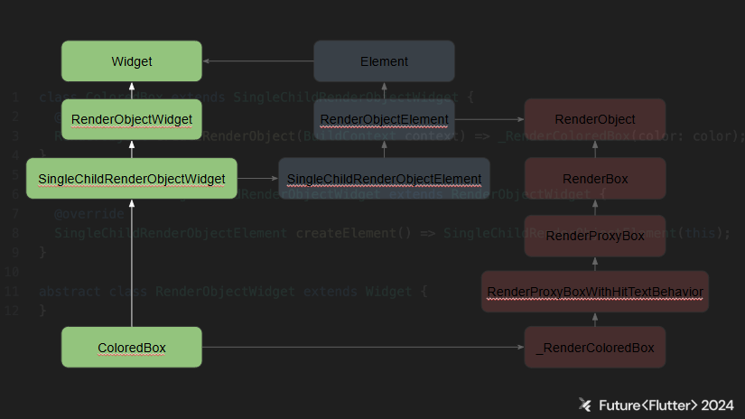

`ColoredBox`가 렌더링되는 자세한 과정을 살펴보려면 `RenderObject`를 반환하는 `createRenderObject`와 `SingleChildRenderObjectElement`를 반환하는 `createElement`를 살펴봐야한다.

아직은 두 메소드가 어떻게 호출되는지 알기 어렵겠지만, 이 내용을 모두 본 후에는 두 메소드가 렌더링에 어떻게 관여하는지 모두 알게될테니 지금은 `createRenderObject`와 `createElement`를 `Widget`에서 오버라이드하고 있다는 사실만 기억한체 넘어가자.

#### Element

이번에는 `SingleChildRenderObjectWidget`이 오버라이드하고 있는 `createElement`가 생성하는 `Element`에 대해 살펴보자.

플러터 공식문서를 보면 `Element` 클래스에 대해 이렇게 설명한다. `"an instantiation of Widget at a particular location in the tree"`, `Element`는 트리의 특정 위치에 있는 위젯을 인스턴스이다.

`Element`의 동작을 확인하기 위해 `SingleChildRenderObjectWidget`의 클래스 계층 구조를 살펴보자.

```dart title="SingleChildRenderObjectWidget"
abstract class SingleChildRenderObjectWidget extends RenderObjectWidget {
  @override
  SingleChildRenderObjectElement createElement() => SingleChildRenderObjectElement(this);
}
class SingleChildRenderObjectElement extends RenderObjectElement {
}
abstract class RenderObjectElement extends Element {
  RenderObject? _renderObject;
  @override
  void mount(Element? parent, Object? newSlot) {
    super.mount(parent, newSlot);
    _renderObject = (widget as RenderObjectWidget).createRenderObject(this);
    attachRenderObject(newSlot);
    super.performRebuilde();
  }
}
abstract class Element extends DiagnosticableTree implements BuildContext {
  Widget? _widget;
}
```

앞서 `ColoredBox` Widget이 확장한 `SingleChildRenderObjectWidget`은 `createElement` 메소드를 통해서 `SingleChildRenderObjectElement`를 생성하는걸 살펴보았다. `SingleChildRenderObjectElement`는 `RenderObjectElement`를 확장하고 있고, `RenderObjectElement`는 `Element`를 확장하고 있다.

`Element`는 `BuildContext`를 구현한 추상클래스로 `Widget`을 프로퍼티로 들고, 필요한 시점에 `build` 메소드를 호출하게 된다. 이를 표에 추가하면 다음과 같이 표현할 수 있다.

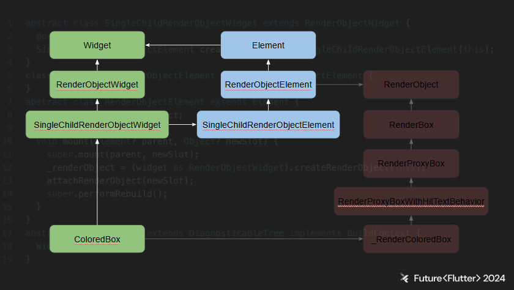

`Element` 클래스의 계층 중 렌더링과 관련해서 주의깊게 살펴볼 부분은 `RenderObjectElement` 클래스의 `RenderObject` 프로퍼티와 `mount` 메소드이다.

`mount`가 호출되면 `Widget`의 `createRenderObject` 메소드를 호출해 화면을 그리는데 직접적으로 사용될 `RenderObject`를 생성한다. 생성된 `RenderObject`는 `attachRenderObject`에 전달해 렌더오브젝트의 트리를 구성한다. 그렇다면 이 `mount` 메소드는 어떻게 호출되는 걸까?

#### runApp

`mount`가 호출되는 과정을 살펴보려면 먼저, Widget 만큼 익숙한 `runApp` 함수를 살펴봐야한다. 플러터 프로젝트를 생성하면 `main` 함수에서 `runApp` 함수를 호출하는 코드가 생성되는데, 이 `runApp`을 따라가면 `mount`에 다다를 수 있다.

플러터 공식 문서에서는 `runApp` 함수에 대해 이렇게 이야기한다. `"Inflate the given widget and attach it to the view"` `runApp` 함수는 함수의 인자로 전달한 위젯을 `inflate`하고 `view`에 추가한다. 그렇다면 `Widget`을 어떻게 `inflate`하고, `view`에 추가하는지 `runApp` 함수의 내부 동작을 뜯어보며 확인해보자.

```dart title="runApp"
void runApp(Widget app) {
  final WidgetsBinding binding = WidgetsFlutterBinding.ensureInitialized();
  _runWidget(binding.wrapWithDefaultView(app), binding, 'runApp');
}

mixin WidgetsBinding on BindingBase, ServicesBinding, SchedulerBinding,
  GestureBinding, RendererBinding, SemanticsBinding {
  //...
  //...
  Widget wrapWithDefaultView(Widget rootWidget) {
    return View(
      view: platformDispatcher.implicitView!,
      deprecatedDoNotUseWillBeRemovedWithoutNoticePipelineOwner: pipelineOwner,
      deprecatedDoNotUseWillBeRemovedWithoutNoticeRenderViw: renderView,
      child: rootWidget,
    );
  }
}
```

`runApp` 함수의 내부에서는 `WidgetsFlutterBinding`의 `ensureInitialized`를 호출하여 플러터 어플리케이션 동작을 위한 초기화를 한다. `ensureInitialized`가 반환한 `WidgetsBinding`객체의 `wrapWithDefaultView` 메소드를 호출하면 `runApp` 함수에 전달된 위젯이 `View`의 `child`로 추가되는데 이를 통해 `wrapWithDefaultView`가 view에 위젯을 추가하는 역하를 하는 것을 알 수 있다.

```dart
void _runWidget(Widget app, WidgetsBinding binding, String debugEntryPoint) {
  binding
    ..scheduleAttachRootWidget(app)
    //...
}
```

이번에는 `"Inflate the ginen widget"`를 확인해보자 `runApp` 함수는 `private` 함수인 `_runWidget` 함수의 `scheduleAttachRootWidget`을 호출하며
`wrapWithDefaultView`가 생성한 view를 전달한다.

```dart
mixin WidgetsBinding on BindingBase, ServicesBinding, ScheduleBinding, GestureBinding,
  RendererBinding, SementicsBinding {
    @protect
    void scheduleAttachRootWidget(Widget rootWidget) {
      Timer.run(() => attachRootWidget(rootWidget));
    }
    //...
  }
```

`scheduleAttachRootWidget`은 `attachRootWidget`을 호출하고,

```dart
mixin WidgetsBinding on BindingBase, ServicesBinding, ScheduleBinding, GestureBinding,
  RendererBinding, SementicsBinding {
  //...
  void attachRootWidget(Widget rootWidget) {
    attachToBuildOwner(RootWidget(
      debugShortDescription: '[root]',
      child: rootWidget,
    ));
  }
  void attachToBuildOwner(RootWidget widget) {
    //...
    _rootElement = widget.attach(buildOwner!, rootElement as RootElement?);
  }
```

`attachRootWidget`은 `RootWidget`을 생성해 `attachToBuildOwner`에 전달한다. `attachToBuildOwner` 메소드에서는 인자로 전달된 `RootWidget`의 `attach`를 호출하는데, `attach`의 두 번째 인자에는 `rootElement`가 `null`인 상태로 호출된다.

```dart
class RootWidget extends Widget {
  RootElement attach(BuildOwner owner, [ RootElement? element ]) {
    if (element == null) {
      owner.lockState(() {
        element = createElement();
        element!.assignOwner(owner);
      });
      owner.buildScope(element!, () {
        element!.mount(/* parent */ null, /* slot */ null);
      });
    } //...
  }
}
```

`RootWidget`의 `attach`에서는 `createElement`를 호출해 `RootElement`를 생성하고, 생성된 `RootElement`의 `mount`를 호출한다.

```dart
class RootElement extends Element with RootElementMixin {
  @override
  void mount(Element? parent, Object? newSlot) {
    //...
    _rebuild();
  }
  void _rebuild() {
    //...
    _child = updateChild(_child, (widget as RootWidget).child, /* slot */ null);
  }
}

abstract class Element extends DiagnosticableTree implements BuildContext {
  Element? updateChild(Element? child, Widget? newWidget, Object? newSlot) {
    //...
    final Element newChild = inflateWidget(newWidget, newSlot);
    return newChild;
  }
}
```

`RootElement`의 `mount`는 `_rebuild`, `updateChild`를 거쳐 `inflateWidget`을 호출하는데 `runApp` 함수가 위젯을 `inflate`하는 역할을 `RootElement`에서 수행한다.

정리하자면 `runApp` 함수는 `RootWidget`, `RootElement`를 생성해 위젯트리와 엘리먼트 트리의 루트를 생성하고, `widget`의 `build` 메소드를 계층적으로 호출하기 위한 트리를 구성하는 역할을 한다.

```dart
abstract class RenderObjectElement extends Element {
  RenderObject? _renderObject;
  @override
  void mount(Element? parent, Object? newSlot) {
    super.mount(parent, newSlot);
    _renderObject = (widget as RenderObjectWidget).createRenderObject(this);
    attachRenderObject(newSlot);
    super.performRebuild();
  }
}
```

위젯이 계층적으로 생성되는 과정에서 렌더링에 관여하는 `RenderObjectElement`의 `mount`가 호출되는데 이때 렌더링에 사용되는 `RenderObject` 객체가 생성되고, 렌더트리에 추가되는 것이다.

#### RenderObject

렌더링에 직접적으로 관여하는 `RenderObject`에 도달하기까지 기나긴 여정이었다. 실제 렌더링은 비교적 단순하다. `RenderObject`는 공식 문서에서 **렌더트리**를 구성하는 오브젝트라 설명한다. 렌더트리를 구성하는 다양한 `RenderObject`가 렌더링을 처리하는 것이다. `RenderObject`는 직접적인 페인팅 외에도 레이아웃과 유저 입력에 대한 영역 검사, 접근성 등을 처리하는데, 이번 시간에는 `RenderObject`의 다양한 역할 중 페인팅에 대해 자세히 알아보자.

```dart
class ColoredBox extends SingleChildrenderObjectWidget {
  @override
  RenderObject createRenderObject(BuildContext context) => _RenderColoredBox(color: color);
}
class _RenderColoredBox extends RenderProxyBoxWithHitTestBehavior {
  _RenderColoredBox({ required Color color }) :
    _color = color, super(behavior: HitTestBehavior.opaque);

  //...
  @override
  void paint(PaintingContext context, Offset offset) {
    if (size > Size.zero) {
      context.canvas.drawRect(offset & size, Paint()..color = color);
    }
    if (child != null) {
      context.paintChild(child!, offset);
    }
  }
}
```

다시 `ColoredBox` 위젯을 확인하자 `ColoredBox` 위젯의 `createRenderObject`에서는 `_RenderColoredBox`를 생성한다. `_RenderColoredBox` 클래스의 계층을 정리하면 `RenderProxyBoxWithHitTestBehavior`를 확장하고 있는걸 볼 수 있는데, `RenderProxyBox`, `RenderBox`를 거쳐 `RenderObject` 계층을 구성하는 것을 볼 수 있다.

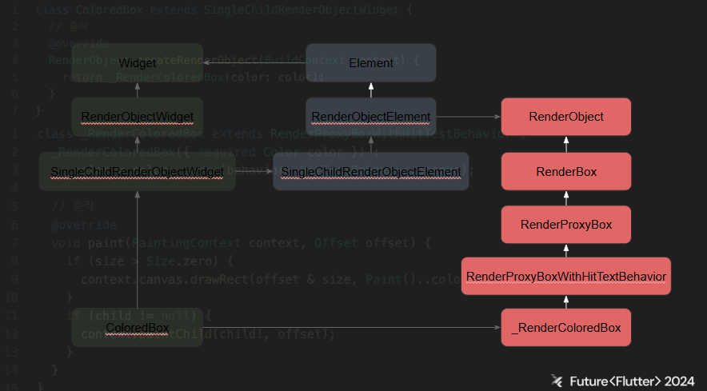

이로써 드디어 `Widget`, `Element`, `RenderObject`의 계층과 의존 관계가 완성되었다.

`Widget`, `Element`, `RenderObject`를 거치는 과정을 통해 최종적으로 페인팅 될 때는 `RenderObject`의 `paint` 메소드가 호출된다. `paint` 메소드가 호출되면 메소드의 인자로 전달된 `PaintingContext`의 `canvas`로 `drawRect` 메소드를 호출한다.

```dart
base class _NativeCanvas extends NativeFieldWrapperClass1 implements Canvas {
  @override
  void drawRect(Rect rect, Paint paint) {
    //...
    _drawRect(rect.left, rect.top, rect.right, rect.bottom, paint._objects, paint._data);
  }

  @Native<Void Function(Pointer<Void>, Double, Double, Double, Double, Handle, Handle)>
    (symbol: 'Canvass::drawRect')
  external void _drawRect(
    double left, double top, double right, double bottom,
    List<Object?>? paintObjects, ByteData paintData
  );
}
```

`canvas`는 `_NativeCanvas`의 객체로 `drawRect`를 따라가면 `c++`로 구현된 플러터 렌더일 엔진이 최종적으로 페인팅을 하며 길고 긴 렌더링 여정을 마치게 된다.

### 위젯 커스터마이징과 쉐이더를 활용한 렌더링

이번에는 `ColoredBox`가 아닌 위젯을 커스터마이징과 쉐이더 2가지 방식을 활용해 화면을 녹색으로 칠하도록 만들며 앞서 살펴본 플러터 렌더링 과정을 되새겨보자.

#### Widget과 RenderObject 커스터마이징

자식 위젯을 가질 수 없는 간단한 위젯을 `Widget`과 `RenderObject`의 커스터마이징을 통해 구현해보자

먼저 `drawRect`로 주어진 영역과 색으로 화면을 칠하는 `RenderObject`를 구현해보자

```dart
class RenderNoChildColoredBox extends RenderBox {
  final Paint _paint = Paint();
  Color _color;

  RenderNoChildColoredBox({required Color color}) : _color = color;

  set color(Color newColor) {
    if (_color != newColor) {
      _color = newColor;
      markNeedsPaint();
    }
  }

  @override
  void paint(PaintingContext context, Offset offset) {
    context.canvas.drawRect(offset & size, _paint..color = _color);
  }
}
```

유저의 입력을 처리할 필요도 없고, 자식 위젯을 통해 자식 렌더오브젝트를 렌더링할 필요도 없기 때문에 단순히 자신의 위치와 크기만 계산해 렌더링하는 `RenderBox`를 확장해 `RenderNoChildColoredBox`라는 클래스를 선언하였다.

`RenderNoChildColoredBox` 클래스는 색상을 생성자로 받아 프로퍼티를 초기화 한다. `color`에 대한 `setter`도 구현해 외부에서 전달된 `color` 값이 프로퍼디의 값과 같은지 검사한 후, 다른 경우에만 `repaint`를 위해 `markNeedsPaint` 메소드를 호출하도록 구현한다. 이는 플러터 렌더링 최적화의 핵심 매커니즘 중 하나이므로 `RenderObject`를 직접 확장할 때 `martNeedsPaint`가 불필요하게 호출되지 않도록 해야한다.

`RenderNoChildColoredBox`가 위젯 트리에 `attach` 되거나 `markNeedsPaint`에 의해 `repaint`할 `render object`로 등록된다면 다음 프레임에 `paint` 메소드가 호출되는데, 앞서 살펴본 `ColoredBox`의 `paint`와 마찬가지로 `canvas`의 `drawRect` 메소드를 호출해 `offset`과 `size`, `color` 속성을 이용해 화면을 칠한다.

이제 `RenderNoChildColoredBox`를 렌더링에 사용하는 커스텀 `NoChildColoredBox` 위젯도 구현해보자.

```dart
class NoChildColoredBox extends LeafRenderObjectWidget {
  final Color color;
  const NoChildColoredBox({super.key, required this.color});

  @override
  RenderNoChildColoredBox createRenderObject(BuildContext context) {
    return RenderNoChildColoredBox(color: color);
  }

  @override
  void updateRenderObject(
    BuildContext context,
    RenderNoChildColoredBox renderObject,
  ) {
    renderObject.color = color;
  }
}
```

자식 위젯을 사용하지 않는 위젯을 만들기 위해 `SingleChildRenderObjectWidget` 대신 `LeafRenderObjectWidget`을 확장한 후, 화면에 칠할 `Color` 속성을 생성자로 전달 받는다.

`createRenderObject`를 오버라이드해 렌더링에 사용할 `RenderObject`인 `RenderNoChildColoredBox`를 생성해 반환한다.

`updateRenderObject` 메소드를 오버라이드하며, `updateRenderObject`의 두 번째 인자는 렌더링에 사용할 `RenderNoChildColoredBox` 타입으로 선언한다. 플러터는 widget이 `rebuild` 되어도 `Element` 트리에 대한 변경이 없다면 `RenderObject`를 재사용한다.

이렇게 만들어진 `NoChildcoloredBox` 위젯은 `ColoredBox` 위젯과 달리 자식 위젯에 레이아웃이나 유저 입력 처리를 위한 영역 검사 등을 할 필요가 없어 화면을 칠하는데 특화된 경량 위젯이 생성되는 것이다.

#### CustomPaint와 CustomPainter 그리고 Fragment Shader

다음으로 프래그먼트 쉐이더를 알아보자 프래그먼트 쉐이더는 **GPU**로 렌더링한다. 다음은 **Nvidia**가 2008년도에 **Nvision**이라는 행사에서 CPU와 GPU의 차이를 보여주기 위한 영상이다.

| CPU                                                                          | GPU                                                                          |
| ---------------------------------------------------------------------------- | ---------------------------------------------------------------------------- |
|  |  |

영상에서 보는 방식을 프래그먼트 쉐이더의 동작방식을 잘 보여준다. 프래그먼트 쉐이더는 픽셀 쉐이더라 하는데, 화면을 구성하는 각 픽셀이 출력할 RGBA 값을 GPU를 통해 **병렬** 처리한다. 이러한 `FragmentShader`를 플러터에서는 `CustomPainter`로 간단히 활용할 수 있다.

```dart
class ShaderPainter extends CustomPainter {
  final Color color;
  final FragmentShader shader;
  final Paint _paint = Paint();

  ShaderPainter({required this.color, required this.shader});

  @override
  void paint(Canvas canvas, Size size) {
    shader.setFloat(0, color.red. toDouble() / 255);
    shader.setFloat(1, color.green.toDouble() / 255);
    shader.setFloat(2, color.blue.toDouble() / 255);
    canvas.drawRedt(
      Rect.fromLTWH(0, 0, size.width, size.height),
      _paint..shader = shader,
    );
  }

  @override
  bool shouldRepaint(ShaderPainter oldDelegate) =>
    color != olddelegate.color || shader != oldDelegate.shader;
}
```

`CustomPainter`를 확장해 `_ShaderPainter` 클래스를 선언한다. `Color`와 `FragmentShader`를 선언하고 생성자로 전달받아 초기화한다. `FragmentShader` 객체를 생성하는 과정은 잠시 뒤에 살펴보자.

`CustomPainter`의 `paint` 메소드를 오버라이드 한다. `paint` 메소드에는 `FragmentShader`의 `setFloat` `0, 1, 2` 인덱스로 `color` 속성의 `red, green, blue` 값을 전달한다. 여기에서 사용된 인덱스는 `FragmentShader` 스크립트에 매핑될 값의 인덱스를 의미하는데 이 역시 잠시 후 `Fragment Shader` 스크립트를 자세히 살펴볼 때 알아보자.

이제 화면을 칠하기 위해 `paint` 메소드로 전달된 `canvas` 객체로 `drawRect` 메소드를 호출하고, `Paint` 객체의 `shader`에 화면을 칠할 때 사용할 `fragment shader` 객체를 전달한다.

`shouldRepaint`도 오버라이드 한다. `CustomPainter` 사용 시 최적화를 위해 중요한 메소드로 `rebuild`에 의해 새롭게 생성된 `CustomPainter`의 속성과 `shouldRepaint`의 인자로 전달된 이전 `CustomPainter`의 속성을 비교해 상태가 변경된 경우에만 `repaint`가 되도록 이전 상태와 비교 후 `true` 혹은 `false`를 반환하도록 구현한다.

```dart
FutureBuilder(
  future: FragmentProgram.fromAsset('assets/shaders/helloworld.frag'),
  builder: (context, snapshot) {
    final fragmentProgram = snapshot.data;
    if (fragmentProgram != null) {
      return CustomPaint(
        painter: ShaderPainter(
          color: color,
          shader: fragmentProgram.fragmentShader(),
        ),
      );
    } else {
      return const Center(child: CircularProgressIndicator());
    }
  },
)
```

`CustomPainter`를 확장한 `ShaderPainter` 객체를 `CustomPaint`의 `painter`로 전달한다.

`helloworld.frag`라는 쉐이더 파일을 `FragmentProgram.fromAsset`으로 쉐이더 파일을 비동기로 로드한 뒤, 로드가 완료되면 `fragmentShader` 메소드를 호출해 `fragmentProgram`으로 변환한 뒤 `ShaderPainter`에 전달한다.

`helloworld.frag`를 살펴보자

```frag
#version 460 core                       // OpenGL 버전(4.6)

#include <flutter/runtime_effect.glsl>  // 플러터 사전 구현된 코드 추가

uniform float r;                        // 쉐이더 외부에 전달 받을 값
uniform float g;
uniform float b;

out vec4 FragColor;                     // 쉐이더 출력값

void main() {                           // 프래그먼트 쉐이더 함수
  FragColor = vec4(r, g, b, 1);
}
```

```helloworld.frag` 쉐이더는 확장자에서 알 수 있듯 프래그먼트 쉐이더이다. 프래그먼트 쉐이더 상단에는 **OpenGL** 버전을 명시하고 `include`로 플러터 엔진에 사전 구현된 코드를 사용하기 위해 추가한다. `include`를 통해 다양한 픽셀 색상 연산에 다양한 유틸 함수나 상수를 사용할 수 있게된다.

`uniform`으로 3개의 `float` 변수 `r, g, b`를 선언 했는데 `uniform`으로 변수를 선언하면 쉐이더 외부에서 인덱스를 통해 값을 전달할 수 있게된다.

```dart
@override
void paint(Canvas canvas, Size size) {
  shader.setFloat(0, color.red.toDouble() / 255);
  shader.setFloat(1, color.green.toDouble() / 255);
  shader.setFloat(2, color.blue.toDouble() / 255);
  canvas.drawRect(
    Rect.fromLTWH(0, 0, size.width, size.height),
    _paint..shader = shader,
  );
}
```

앞서 쉐이더를 사용한 `paint` 메소드에서 `setFloat`를 호출하며 `0, 1, 2` 인덱스와 함께 전달한 값이 프래그먼트 쉐이더의 `uniform` 변수에 전달되는 것이다.

`out`으로 선언한 변수는 `uniform`과 반대로 출력값이며, `vec4`로 `rgba` 색상을 표현한다.

`main`은 프래그먼트 쉐이더 함수의 진입점이다. `main` 함수에서는 `uniform`으로 전달된 값을 `vec4`에 담아 출력값을 만드는 간단한 쉐이더로 구성된 것을 볼 수 있다. 이상 단순히 외부에서 전달한 값을 출력값으로 만드는 예제였다.

### 렌더링 최적화

`widget`, `element`, `renderobject`를 통해 랜더링되는 과정을 살펴보았고, `widget`과 `renderObject`를 커스터마이징해보기도 하고 custom paint, painter, fragment shader를 활용해 화면을 칠하는 방법을 살펴보았다.

플러터팀에서는 16ms 이내 build, 16ms paint를 처리하도록 가이드한다. 단일 위젯의 build와 paint가 아닌 한 프레임에 처리하는 모든 위젯과 렌더오브젝트의 build와 paint를 각 각 16ms에 처리해야한다는 것이다. 영상이나 게임, 모바일 운영체제의 fps가 60프레임을 지원하며 유저의 눈높이는 보다 높아졌다. 랙이 없는 부드러운 애니메이션을 위해서는 60fps를 유지해야하는데, 이를 위해서는 상태 변경에 따라 rebuild, repaint 되는 모든 위젯과 렌더오브젝트가 매 프레임마다 각 각 8ms 이내 처리되어야함을 의미한다.

8ms의 paint를 위해 `shouldRepaint`에서 화면을 다시 그릴지 여부를 반환하고 `markNeedsPaint`에서 화면을 다시 그리도록 예약하는 로직의 어떤 공통점이 렌더링을 최적화해줄까? 공통점은 단순하다 **그리지 않기** 컴포넌트를 분리하고 리빌드 되는 컴포넌트를 격리해 리빌드 되는 위젯을 최소화하고 위젯 트리에 단순하게 구성하고 필요에 따라 컴포지션이 아닌 위젯을 직접 만들고 렌더링 과정에서 살펴본 상태 비교 조건 처리 후 `repaint` 여부 검사를 하는 등의 모든 과정들이 모두 그리지 않기 위한 전략을 통해 최적화를 하고 있는 것 이다.

그리지 않는 단순한 전략을 기억하고, 우리 모두가 고품질의 렌더링을 제공하는 앱을 개발하는 플러터 전문가로 나아가자.

## Flutter web을 활용하여 제품 개발 환경 개선하기

라인 데마에칸 서비스를 플러터 환경으로 전환하며 겪었던 문제점들 중 테스트 환경과 관련하여 고민해본 내용을 공유해주었다. 동료들이 테스트 환경에 더 적극적으로 찹여할 수 있도록 하기위해 테스트 -> 피드백 -> 개선 사이클을 최소화 하기위한 방안을 고민하였으며, 이를 웹 배포를 통해 어떻게 해결하였는지 공유해주는 시간이었다.

이를 참고하여 Web FrontEnd에서 많이 활용중인 Storybook과 유사한 Widgetbook과 Static Web 사이트 배포를 통해 현재 회사에서도 테스트 환경을 개선하여 디자이너와 기획자 동료분들로 부터 지속적이고 즉각적인 피드백을 받을 수 있는 환경을 구성할 수 있는 계기가 되었다.

### 왜 Flutter Web인가?

테스트 환경을 제공해주기 위해서는 여러 방법이 있을 것이다. 기존에는 SDK 파일로 컴파일하여 실제 디바이스에 실행가능한 상태로 제공해주는 방법을 많이 활용하였다. 하지만 이렇게 제공해주게 된다면 사람들은 본능적으로 최대한 한번에 보여주기 위해 노력하므로, 기능들이 어느정도 누적되었을 때 공유하기를 원한다. 따라서 디자이너나 기획자가 수정사항을 확인할 때에도 너무 많은 기능들이 포함 되어있어, 꼼꼼하게 기능들을 모두 확인하기는 어렵다.

프로그래밍에 있어서도 이러한 문제점을 개선하기 위해 현재 많은 기업들에서 지속적인 배포를 지향하고 있다. 테스트에도 이러한 문제점을 개선하기 위해 지속적으로 테스트 환경을 업데이트해줄 필요가 있다.

이번 발표에서 말하는 Web 배포의 핵심 요소는 아래의 3가지이다.

- 앱 제품 개선 과정 효율화
- 물리적 제약사항 극복
- 프로덕션 수준으로 서비스를 출시하려 노력하지 않아도 됨

우선, 앱 제품을 개선하기 위해 의사소통 과정을 효율화 하여야 한다. 이는 처음에 말했듯 지속적 개발과 연관되어 있다. 다음으로는 물리적 제약사항을 극복하기 위함이다. 라인의 경우 일본, 동남아 등 여러 나라에서 기획자들과 디자이너들이 근무하고 있어 디바이스에 프로그램을 직접 배포하여 전달해주기에는 물리적으로 힘들다. 따라서 특정 디바이스가 필요 없는 웹을 통해 공유하는 방법을 생각했다. 마지막으로 테스트 환경은 실제 프로덕션 수준으로 서비스를 출시하지 않아도 된다. 테스트 환경은 말그대로 테스트를 위한 환경, 우리의 서비스가 정상적으로 동작하는지를 확인하기 위한 것으로 실제 서비스와 동일한 수준으로 만들지 않아도 된다. 이 부분을 핵심 요소로 꼽은 이유는 모바일 디바이스 환경과 Web 브라우저 환경의 차이 때문이다. 대표적으로 모바일 디바이스의 경우 세션 스토리지, 쿠키를 설정할 수 없으므로 모두 디바이스 로컬 메모리에 저장하거나 Secure memory에 저장해주게 된다. 이러한 코드를 웹에서 그대로 실행하려면 문제가 발생하므로 만약, 웹에서도 프로덕션 수준으로 배포를 하여야한다면 문제가 된다. 하지만 우리는 테스트 환경을 화면이 어떻게 구성되는지, 기능들이 정상적으로 상호작용 하는지만 보기 위함이므로 이러한 요소들은 우회하여도 된다.

### Web 빌드 및 배포 시도 사례

그렇다면 Web 빌드 시 발생하는 문제점들과 이를 해결하는 방법에는 어떤 것들이 있을까? 라인 데마에칸 시스템에서 실제로 시도한 과정에서 발생한 문제점들과 이를 해결한 방법들을 통해 대표적인 문제점들을 살펴보자

#### Unsupported operation: Platform.\_operatingSystem

플랫폼 분기를 위해 사용중인 `Platform.isAndroid, Platform.isIOS` 코드에서 발생하는 오류이다.

```bash
Error: Unsupported operation: Platform._operatingSystem
```

Andoid, iOS 등 멀티플랫폼 환경을 제공하는 서비스라면 플랫폼 분기가 반드시 필요하다. 하지만 이렇게 특정 플랫폼만을 위한 코드를 작성하게 되면 어떤 플랫폼에도 속하지 않는 웹 브라우저 환경에서는 에러가 발생한다. 이를 해결하기 위해 해당 팀에서는 `defaultTargetPlatform`을 활용하여 플랫폼 분기 코드에 대응하도록 수정하였다.

```dart
import 'dart:io';

import 'package:flutter/foundation.dart';

class PlatformUtils {
  static bool get isWeb => kIsWeb;

  static bool get isAndroid => defaultTargetPlatform == TargetPlatform.android;

  static bool get isIOS => defaultTargetPlatForm == TargetPlatform.iOS;

  static String get localeName => isWeb ? "ja_JP" : Platform.localeName;
}
```

##### AS-IS

```dart
void showInfoDialog() {
  if (Platform.isIOS) {
    showActionSheet( ... );
  } else {
    showSystemDialog( ... );
  }
}
```

##### TO-BE

```dart
void showInfoDialog() {
  if (PlatformUtils.isIOS) {
    showActionSheet( ... );
  } else {
    showSystemDialog( ... );
  }
}
```

위와 같이 `PlatformUtils` 라는 클래스를 생성하여 `Platform`을 래핑하고 `DefaultPlatform`을 추가하여 `Platform`이 예상하는 값과 다를 때 처리하는 구문을 추가해주었다.

#### h3_flutter package update

특정 패키지들의 경우 버전이나 종속성으로 인한 문제로 에러가 발생할 수 있을 것이다. 발표자료에서는 Uber에서 개발한 지구 계층을 육각형 그리드로 매핑해놓은 패키지에서 에러가 발생하여 설명해주었다.
h3_flutter 0.4.2를 사용할 때 에러가 발생하였고 0.6.6 버전 이후부터 웹을 지원하였지만 Android에서 빌드 오류가 발생하여 이슈 리포트를 통해 이를 수정하도록 요청하여 문제를 해결하였다.

#### Unsupported operation: Trying to use the default webview

개인정보 취급방침, 이용약관, 공지사항 등 WebView 화면에서 오류가 발생하였다. `webview_flutter: ^3.0.4` 를 사용 시 웹에서 빌드를 하면 에러가 발생한다. 이를 `webview_flutter_web: ^0.1.0+4`를 추가하여 해결하였다. 웹뷰 위젯 구현부를 **조건부 임포트**를 활용하여 실행가능한 패키지로 실행되도록 해준 것이다.

```dart
import 'package:flutter/material.dart';
import 'package:driver_app/ui/lib/widget/webview_app.dart'
  if(dart.library.html) import 'package:driver_app/ui/lib/widget/webview_web.dart';

class SimpleWebView extends StatelessWidget {
  const MyApp({
    ...
    super.key,
  });

  @override
  Widget build(BuildContext context) => WebViewImpl(
    ...
  );
}
```

#### flutter_secure_storage - DomException

데이터를 암호화하여 저장하기 위해 사용하는 패키지이다. 특정 데이터를 읽어오는 경우 **DomException**이 발생한다.

키가 `{category}::{keyName}` 형식인 경우 이슈가 발행하여 `{keyName}` 형식으로 수정해주면 해결된다.

```dart
/// Encrypts and saves the [key] with the given [value].
///
/// If the key was aleady in the storage, its associated value is changed.
/// If the value is null, deletes associated value for the given [key].
@override
Future<String?> read({
  required String key,
  required Map<String, String> options,
}) async {
  final value = web.window.localStorage("${options[_publicKey]!}.$key");

  return _decryptValue(value, options);
}
```

#### XMLHttpRequest error

웹에서 API 통신을 시도할 경우 오류가 발생한다. **CORS (Cross-Origin Resource Sharing) issue**

**로컬 개발 환경**에서 chrome 실행 시 `--disable-web-security`를 설정하여 대응하였다.

##### Set `--disable-web-security` options

1. `flutter/bin/cache` 이동 후 `flutter_tools.stamp`를 제거한다.
2. `flutter/package/flutter_tools/lib/src/web/chrome.dart` 파일을 연다.
3. `--disable-web-security` 옵션을 추가한다.

**로컬 개발 환경**에서 chrome 실행 시 보안 설정을 수정한다. 실제 배포 환경에서 수정하지 않도록 주의 한다.

#### Cross-Origin Resource Sharing (CORS)

Cross-Origin Resource Sharing (CORS) 란? **브라우저**가 **자신의 출처(Origin)가 아닌 다른 출처로부터 자원 로드를 허용**하도록 서버가 허가해주는 HTTP 헤더 기반의 메커니즘으로 출처가 다른 서버간의 리소스 공유를 허용하는 것이다.

<aside class="callout info">

<strong>Origin(출처)란?</strong>


URL (Uniform Resource Location) 구조에서 **Protocol + Host + Port** 부분을 의미한다.

`https://future-flutter.dev:8080/sessions/detail?page=3#flutter_web`

`https://`: Protocol

`future-flutter.dev`: Host

`:8080`: Port

`/sessions/detail`: Path

`?page=3` Query String

`#flutter_web`: Fragment


</aside>


##### CORS - flow of preflight request case

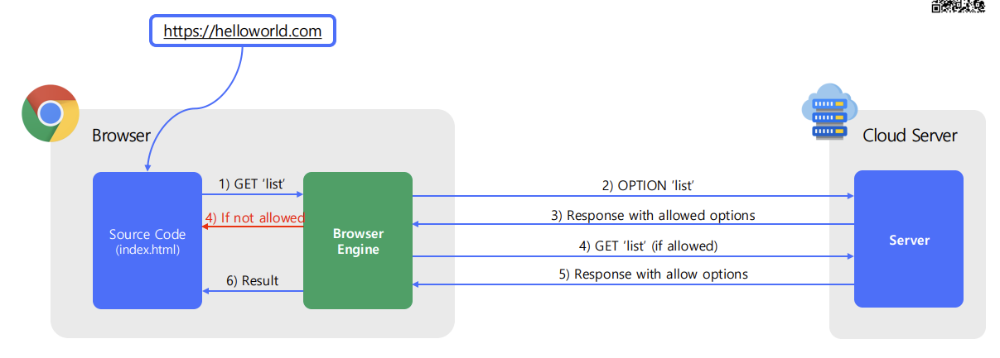

##### Enabling --disable-web-secure

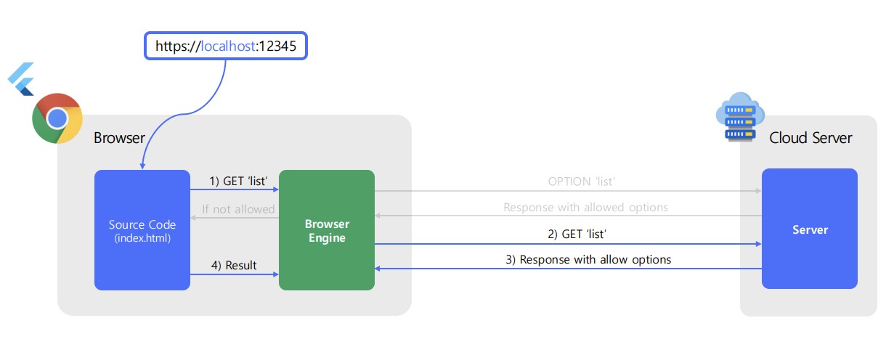

#### (Tip) use `flutter_cors` tools

여러 버전의 flutter SDK 를 사용할 경우 유용하다.

```bash
// install 'flutter_cors'
$ dart pub global activate flutter_cors

// disable chrome web security option
$ fluttercors -d -p {flutter_sdk_path}
// enable chrome web security option
$ fluttercors -e -p {flutter_sdk_path}
```

#### Permission acquisition scenario (reviewing)

권한획득 시나리오의 경우도 너무 복잡하여 웹에서 대응하기 어려웠다고 한다.

|Android|iOS|
|--|--|
|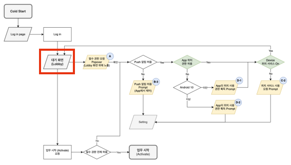|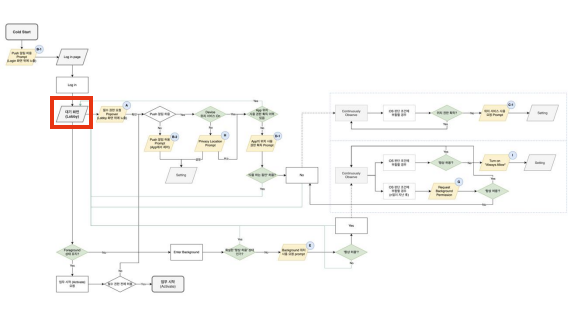|

#### Web support platform not available (reviewing)

웹을 미지원 하는 패키지로 인한 이슈도 있다.

해당 팀에서 개발 당시 기기 의존적인 기능들이 많았는데 당시에는 그러한 패키지들이 거의 없어 특히 **웹에서 지도를 표현** 하는 문제가 가장 컸다고 한다.

이러한 부분들은 최근 많은 패키지들이 웹에서도 지원되도록 개선되어 어느정도 해소되었다.

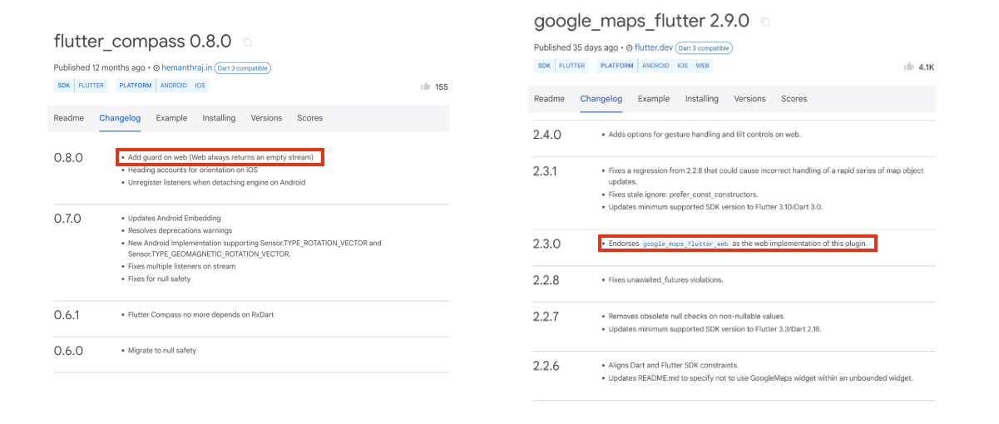

#### 드라이버 앱의 웹 시도 결과

Flutter web 빌드 및 로컬 개발환경까지 준비가 되었지만 웹 환경에서 드라이버 앱을 사용 가능한 수준까지 진행하는 못하였다.

하지만 이 때의 경험을 살려 추후 Flutter Web 과제를 진행하는데 큰 도움이 되었다고 한다.

### 두 번째 Flutter web 시도

Recode & UI/UX 리뉴얼 과제를 진행하며 다시 Flutter web을 시도하였다.

UI/UX를 리뉴얼 하는 과정에서 제품 개선과정의 동기화가 쉽지 않다고 느꼈는데 재택근무로 인한 물리적 제약사항, 기획자 및 관계자들을 위한 앱의 동작 테스트 수단 필요 등을 이유로 Flutter Web 활용을 다시 시도한다.

이전의 Flutter Web 시도 경험을 바탕으로 PoC를 진행하고 컨슈머 앱을 웹에서 확인 가능한 환경을 제공하여 앱 동작을 확인할 수 있는 수단을 제공하려 하였다.

#### ConsumerApp 웹 버전의 목표가 아닌 것

위 과정에서 불필요한 부분은 배제하고 필요한 기능만을 개발하는 것이 가장 중요하였는데 이때 선정한 불필요한 항목은 다음과 같다.

- 기존 웹 서비스를 대체하는 것
- 모바일 기기와 완전히 동일하게 동작하는 것
- 업무 프로세스에 최적화 하는 것

이러한 요소들을 제외하고 해당 팀에서 Flutter 를 활용한 웹 개발 시 겪었던 문제들과 해결 방법을 공유해주었다.

#### Unsupported operation: Platform._operatingSystem

플랫폼 분기를 위해 사용중인 `Platform.isAndroid`, `Platform.isIOS` 코드에서 오류가 발생한다.

이전과 같이 `defaultTargetPlatform`을 사용하여 플랫폼 분기 코드에 대응한다. 이 때 추가로 `CustomLint`를 추가해주어 기본 분기코드를 사용하지 않도록 방지하는 방법도 공유해주었다.

##### Use custom_lint package

```dart
class _UsePlatformHelperLintRules extends DartLintRule {
  const _UsePlatformHelperLintRules() : super(code: _code);

  /// Metadata about the warning that will show-up in the IDE.
  /// This is used for `// ignore: code` and enabling/disabing the lint
  static const _code = LintCode(
    name: 'use_platformhelper_instead',
    problemMessage: "'Platform.{0}' should not be used",
    correctionMessage: "Use 'PlatformHelper.{0}' instead",
    errorSeverity: ErrorSeverity.ERROR,
  );

  @override
  void run(
    CustomLintResolver resolver,
    ErrorReporter reporter,
    CustomLintContext context,
  ) {
    /// The addPrefixedIdentifier checks the grammar of the [xxx].[xxx] format to forward the callback as node.
    context.registry.addPrefixedIdentifier((node) {
      final beginToken = node.beginToken;
      final endToken = node.endToken;
      if (beginToken.value().toString() == 'Platform' && endToken.value().toString() == 'isAndroid' || beginToken.value().toString() == 'Platform' && endToken.value().toString() == 'isIOS') {
        /// Report a lint error.
        reporter.reportErrorForNode(code, node, [endToken.value().toString()]);
      }
    });
  }
}
```

#### Update packages

웹 빌드 시 패키지 내부에서도 오류가 발생한다. 참조 패키지에서 `dart:ffi` import 중 오류가 발생하여 확인하자 이후 해당 오류를 수정한 버전이 올라와 있었다고 한다.

Flutter Web 도 출시된지 어느정도 시간이 지나 대부분의 패키지에서는 수정된듯 하다.

##### newrelic_mobile: 1.0.1

```bash
Launching lib/main.dart on Chrome in debug mode...
main.dart:1
: Error: Dart library 'dart:ffi' is not available on this platform.
newrelic_mobile.dart:7
import 'dart:ffi';
       ^
// highlight-start
Context: The unavailable library 'dart:ffi' is imported through these packages:

web_entrypoint.dart => package:consumer_app => package:newrelic_mobile => dart:ffi
// highlight-end

Detailed import paths for (some of) the these imports:
...

Failed to compile application.
Exited
```

`dart:ffi` 패키지의 경우 웹에서는 사용할 수 없다. 따라서 해당 패키지를 사용하는 `newrelic_mobile` 1.0.1 버전을 사용하면 위 에러가 발생하는데, 다음과 같이 1.0.3 버전 이후 해당 부분이 수정된 것을 볼 수 있다.

[Commit log](https://github.com/newrelic/newrelic-flutter-agent/commit/2690bc968ba1833bbf80618f19bafc1bc70840c4)
```dart title="Added 'import dart:ffi' at (1.0.1)"
import 'dart:async';
import 'dart:ffi';
import 'dart:io' show HttpOverrides, Platform;

import 'package:flutter/foundation.dart';
```

[Commit log](https://github.com/newrelic/newrelic-flutter-agent/commit/017416eb6bede3de86319807ab52568a91223063)
```dart title="Removed 'import dart:ffi' at (1.0.3)"
import 'dart:async';
// highlight-next-line
- import 'dart:ffi';
import 'dart:io' show HttpOverrides, Platform;

import 'package:flutter/foundation.dart';
```

#### Support web platform

- **flutter_inappwebview: 6.0.0**: 웹 실행 시 오류 발생
- **fpjs_pro_flugin: ^3.0.0**: 전화번호 인증 flow 에서 오류 발생

위 두 패키지의 경우 웹에서 실행 시 오류가 발생하였고 각각 `index.html`에 `web_support.js`, `index.js`를 추가해주어 해결했다.

```html
<!-- ... -->
<script type="application/javascript" src="/assets/packages/flutter_inappwebview_web/web_support.js" defer />
<script src="assets/packages/fpjs_pro_plugin/web/index.js" defer />
```

#### Do not use package when run on web

웹 환경에서는 앱의 기능을 제공할 수 없는 패키지들도 있다. 이러한 패키지들은 의도적으로 웹 환경에서는 미지원 하도록 처리가 필요하다.

해당 기능을 위해 플랫폼 별 다른 구현체를 반환하는 패턴으로 수정하여 패키지 인터페이스를 직접 사용하지 못하도록 Custom Lint 를 추가하여 해결하였다.

```bash title="main.dart 문제 2개 중 1개"
'FlutterAppBadger.***' should not be used
Use '$appBadger.***' instead dart(use_app_badger)
```

##### Case of fluuter_app_badger usage

```dart title="app_badger.dart"
AppBadger get $appBadger => PlatformHelper.isWeb ? _AppBadgerWeb() : _AppBadgerImpl();

abstract class AppBadger {
  Future<void> updateBadgeCount(int count);
  Future<void> removeBadge();
}

// AS-IS
FlutterAppBadger.updateBadgeCount(count);
// TO-BE
$appBadger.updateBadgeCount(count);
```

```dart title="app_badger_impl.dart"
part of 'app_badger.dart';

class _AppBadgerImpl extends AppBadger {
  @override
  Future<void> removeBadge() => FlutterAppBadger.removeBadge();

  @override
  Future<void> updateBadgeCount(int count) => FlutterAppBadger.updateBadgeCount(count);
}
```

```dart title="app_badger_web.dart"
part of 'app_badger.dart';

class _AppBadgerWeb extends AppBadger {
  @override
  Future<void> removeBadge() {
    debugPrint('AppBadger >> removeBadge');
    return Future.value();
  }

  @override
  Future<void> updateBadgeCount(int count) {
    debugPrint('AppBadger >> updateBadgeCount($count)');
    return Future.value();
  }
}
```

##### $ getter pattern

플랫폼 별 다른 기능을 제공하는 경우 $ getter 형식을 사용하는 것으로 정리하였다.

|Package Name|AS-IS|TO-BE|Support Custom Lint|
|--|--|--|--|
|adjust_sdk|Adjust.***|$adjustUtil.***|O|
|newrelic_mobile|NewrelicMobile.***|$newrelicUtil.***|O|
|flutter_inappwebview|ChromeSafariBrowser()|$chromeSafariBrowser|O|
|flutter_app_badger|FlutterAppBadger.***|$appBadger.***|O|
|firebase_core|Firebase.***|FirebaseUtil.***|X|
|firebase_analytics|FirebaseAnalytics.instance.***|$firebaseAnalytics.***|O|
|firebase_auth|FirebaseAuth.instance.***|$firebaseAuth.***|O|
|firebase_crashlytics|FirebaseCrashlytics.instance.***|$firebaseCrashlytics.***|O|
|firebase_messaging|FirebaseMessaging.instance.***|$firebaseMessaging.***|O|
|firebase_remote_config|FirebaseRemoteConfig.instance.***|$firebaseRemoteConfig.***|O|
|rokt_sdk|RoktSdk.***|$roktSdkUtil.***|X|

##### Support MapView

**platform_maps_flutter: ^1.0.2** 패키지를 사용하여 지도를 표시하여 주었는데, 해당 패키지의 경우 `iOS - AppleMapView / Android - GoogleMapView`를 사용하도록 개발되었기 때문에 웹에서는 별도의 처리가 필요하다.

이를 웹에서는 `google_maps_flutter`를 이용해 맵뷰가 표시되도록 개선하였다.

**In platform_maps_flutter**

```dart
class _PlatformMapState extends State<PlatformMap> {
  @override
  Widget build(BuildContext context) {
    if (Platform.isAndroid) {
      // ...
    } else if (Platform.isIOS) {
      // ...
    }
  }
}
```

**Refactor MapView**

앱에서는 `platform_maps_flutter` / 웹에서는 `google_maps_flutter` 로 맵뷰

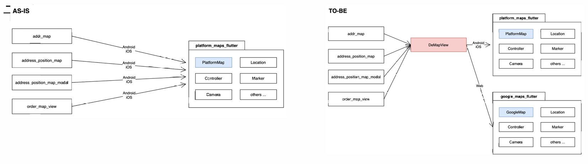

**Add Google Maps JavaScript API**

`index.html`에 **Google Maps JavaScript API** 추가

```html
<head>
  <!-- Other stuff -->
  <script src="https://maps.googleapis.com/maps/api/js?key=YOUR_API_KEY" />
</head>
```

위 방법대로 적용을 하면 로컬 개발환경에서는 `ReferrerNotAllowedMapError`가 발생한다. 하지만 배포 환경에서는 정상적으로 동작한다.

#### Build web

`--base-href` 설정을 할 경우 `web_support.js` 경로 오류가 발생한다. 빌드 완료 후 `index.html` 파일을 수정하는 스크립트를 작성하여 이를 해결하였다.

```dart
// Work-around: `flutter_inappwebview_web` doesn't support `--base-href` option.
// Therefore, the script replaces a javascript path in `index.html`.
// If the library supports that, we can remove below work-around.
const htmlPath = './build/web/index.html'
const originalHtml = Deno.readTextFileSync(htmlPath)
const replacedHtml = originalHtml.replaceAll(
  '/assets/packages/flutter_inappwebview_web/assets/web/web_support.js',
  'assets/packages/flutter_inappwebview_web/assets/web/web_support.js',
)
Deno.writeTextFileSync(htmlPath, replacedHtml)
```

#### Web rendering option changed

build web **--web-renderer** 기본값이 `auto`에서 `canvaskit`로 변경되었다. 또 `SDK 3.22` 부터는 `--wasm`도 사용가능하다(chrome만 지원). 이에 맞춰서 `build` 옵션을 설정해줄 수 있다.

|AS-IS|TO-BE|
|--|--|
|**--web-renderer \{value\}**<br/><br/>`auto` - 모바일 브라우저에서는 `html`, 데스크탑 브라우저에서는 `canvaskit`으로 동작<br/>`html` - 경량적, 웹 표준기술을 사용(하지만 제대로 동작하지 않는 기능이 많음)<br/>`canvaskit` - 고품질 그래픽, 일관된 렌더링|**--wasm**<br/><br/>브라우저가 `wasm`을 지원할 경우 `wasm`, 아닐 경우 `canvaski`으로 동작<br/>이 옵션을 설정하지 않을 경우 `canvaskit`으로 동작<br/><br/>`flutter build web -help` 로 옵션 지원여부 확인 가능|

#### Deploy to web

AWS S3로 static page 배포를 진행하였다. 배포 진행시 아래와 같이 CORS issue가 발생하는데, 해당 발표자분은 인프라팀에 요청을 하여 이슈를 해결하였지만 현재 회사에서 유사하게 `Widgetbook`을 활용한 `Widget visual test` 환경을 구축 중에 동일한 이슈를 해결중이라. 추후 이에 대한 글도 작성할 예정이다.

**CORS issue**
- BFF (API Server)
- Image Server

### 컨슈머 앱의 웹 시도 결과

라인에서는 이렇게 웹 배포를 적용하여 다음과 같이 팀 내부에서 활용 중이다.
- 과제별 개발 진행상황 확인
- 앱 제품에 대한 접근성 대폭 개선
- 주문 ~ 배달 완료 주문 흐름 테스트가 편해짐

위 경험들을 통해 **동료를 유저로 확장하는 경험**을 할 수 있었다.

### 세 번째 Flutter web 시도

위 경험을 바탕으로 리테일 앱도 웹 빌드 및 배포를 진행하게 된다. 리테일 앱이란 **Y!Shopping (LINEヤフー & Demae-can)** 서비스로 매장에서 주문을 수주하고 주문을 배달로 연계하는 서비스이다.

QA 팀에서 웹으로 배포를 요청하여 진행하게 되었고 개발 과정에서 어떻게 활용하였는지 사례를 소개해주었다.

#### Web build & deploy when Pull-Request created.

PR 생성 시, 작업 내용을 실제로 확인하기 위해 Flutter Web 내부 배포를 실행하였다.
- `flutter analyze`, `flutter test`, `spell check` 등 실행
- 플랫폼 별 빌드 실행 < **Web 빌드 시 배포 수행**
- 테스트 실행 결과 및 Web 빌드 결과 확인 URL을 PR Comment 추가
- 매일 업로드된 버킷 목록과 PR 목록을 확인하여 자동으로 클라우드 저장소에 업로드된 웹 빌드물 삭제

#### Deploy to web

Verda cloud로 배포해주었고 마찬가지로 CORS 이슈가 발생하여 이를 인프라팀에 요청하여 해결한다.

**CORS issue**
- CORS header issue
- CORS preflight issue

BFF (API Server) 이슈 수정으로 대응

### Flutter app 을 web 으로 활용 시 고려할 사항

#### Do not use Platform.***

`Platform.isAndroid`, `Platform.isIOS`를 사용하지 않기

```bash
Error: Unsupported operation: Platform._operatingSystem
```

[Unsupported operation: Platform._operatingSystem](#unsupported-operation-platform_operatingsystem)에서 본 것과 같이 **defaultTargetPlatform** class를 생성하여 추가적인이 필요합니다.

#### Consider each package using within the app

1. 웹에서 오류가 발생하는 지 확인한다.

    로컬 개발환경에서 우선 확인

    패키지 추가 시, 웹 환경 설정을 누락했을 가능성이 높다.

2. 관련 **기능이 반드시 필요한지 확인**한다.

    패키지가 웹을 지원하는지 확인하고, 가급적 지원하도록 대응하자.

    (생각보다 많은) 패키지가 웹 환경을 지원한다.

    만약 웹을 지원하지 않을 경우, **Mock 활용을 고려**하자.

    패키지를 업데이트 했으면, 모바일 환경에서 한번 더 체크한다.

3. 반대로, **굳이 필요하지 않은지 판단**한다.

    관련 기능을 웹환경에서 의도적으로 제공하지 않는다.

    인터페이스 호출 시 플랫폼별로 다르게 동작하도록 구성한다.

    앱과 웹의 실행 환경은 다르다는 것을 항상 염두한다.

4. 웹에서 **제약사항을 잘 공유**한다.

    기술적으로 지원이 불가능한 경우가 있을 수 있다.

    앱과 동작이 완벽히 동일하지 않을 수 있다.

    브라우저 쿠키 & 캐시 제거 방법을 공유하자

#### Cross-Origin Resource Sharing (CORS) ?

**브라우저**가 **자신의 출처(Origin)가 아닌 다른 출처로부터 자원 로드를 허용**하도록 서버가 허가해주는 HTTP 헤더 기반의 메커니즘 `출처가 다른 서버간의 리소스 공유를 허용하는 것`

|Origin(출처)?|-|
|--|--|
|URL (Uniform Resource Location) 구조에서<br/> **Protocol + Host + Port**|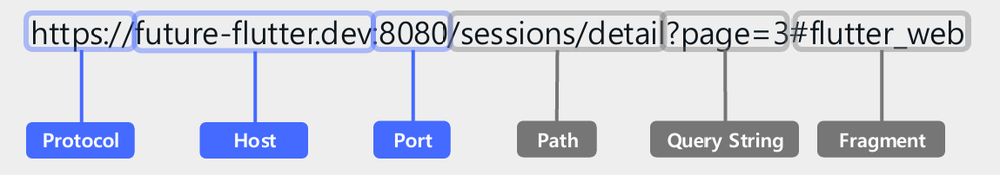|

##### Enabling --disable-web-secure


#### Server-Side configuration

**XMLHttpRequest, unauthorized 200 응답과 함께 데이터가 없는 현상 등**

배포된 웹에서의 접근 허용 작업 요청

- DevOps Engineer
- Server Engineer

#### Use Proxy Server

만약 웹 서비스도 운영 중이면, proxy server 가 존재할 가능성이 높다

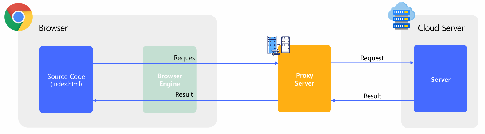

<aside class="callout note">

<strong>참고 자료</strong>


Flutter Web 을 활용해 제품 개발 환경 개선하기 with Future Flutter 2024

[Flutter 엔지니어로 직무 전환한 이야기](https://youtu.be/By9k4vZ__Mk)

[멀쩡한 앱을 Flutter 앱으로 다시 짠이유– 일본 1위 배달앱, 두 번째 Recode](https://engineering.linecorp.com/ko/blog/demaecan-2nd-recode-kmm-to-flutter)

[H3: Uber-s Hexagonal Hierarchical Spatial Index](https://www.uber.com/en-KR/blog/h3/)

[Conditional imports across Flutter and Web](https://medium.com/flutter-community/conditional-imports-across-flutter-and-web-4b88885a886e)

[Window.localStorage](https://developer.mozilla.org/ko/docs/Web/API/Window/localStorage)

[Flutter Web – XMLHttpRequest error](https://github.com/cfug/dio/issues/750)

[How to solve flutter web api cors error only with dart code?](https://stackoverflow.com/questions/65630743/how-to-solve-flutter-web-api-cors-error-onlywith-dart-code/66879350#66879350)

[flutter_cors](https://pub.dev/packages/flutter_cors)

[Flutter 전환의 마침표 – 일본 1위 배달 앱, 세 번째 Recode](https://techblog.lycorp.co.jp/ko/demaecan-3rd-recode-react-native-to-flutter)

[Flutter Web or React Native Web: Who Will Win the Battle?](https://www.expertappdevs.com/blog/flutter-web-vs-react-native-web)

[Flutter에서 커스텀 린트 활용하기](https://techblog.lycorp.co.jp/ko/using-custom-lint-in-flutter)

[Flutter InAppWebView 6 > Web Support](https://inappwebview.dev/blog/flutter-inappwebview-6#web-support)

[Fingerprint Pro Flutter > web support](https://pub.dev/packages/fpjs_pro_plugin#web-platform)

[google_maps_flutter_web > usage](https://pub.dev/packages/google_maps_flutter_web#usage)

[Google Maps Platform > RefererNotAllowedMapError](https://developers.google.com/maps/documentation/javascript/error-messages#referer-not-allowed-map-error)

[Intent to deprecate and remove the HTML renderer in Flutter Web](https://docs.google.com/document/d/1DGamHsa2lz_Qtgfrfa3j3fRaEopJXc7tCFVM1TQlck8)

[Flutter Web을 활용해 제품 개발 환경 개선하기](https://techblog.lycorp.co.jp/ko/improve-development-experience-with-flutter-web)

[교차 출처 리소스 공유 (CORS)](https://developer.mozilla.org/ko/docs/Web/HTTP/CORS)

[CORS, Preflight, 인증 처리 관련 삽질](https://www.popit.kr/cors-preflight-%EC%9D%B8%EC%A6%9D-%EC%B2%98%EB%A6%AC%EA%B4%80%EB%A0%A8-%EC%82%BD%EC%A7%88/)

[SpringBoot에서 CORS할 때 header, preflight 이슈 해결하기](https://velog.io/@ojwman/spring-boot-cors-header-preflight)

</aside>


## 어느날 갑자기 앱이 터졌을 때

## Flutter Bloc을 제품 개발에 야무지게 적용하기
