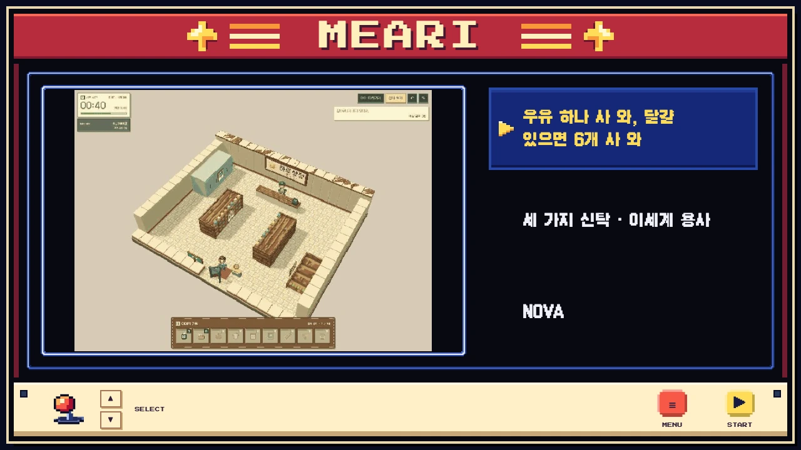

메아리(MEARI)에 들어가면 왼쪽 모니터에 장보기 게임이 떠 있다. 아래쪽 조이스틱을 한 칸 내리면 오른쪽의 노란 화살표가 다음 제목으로 옮겨 가고, 모니터도 그 게임의 장면으로 바뀐다. 직접 만든 브라우저 게임 세 편의 입구를 이렇게 한 대의 오락기로 만들었다.

<!--truncate-->

## 한 칸 내려서 게임 고르기

첫 번째 타이틀은 「우유 하나 사 와, 달걀 있으면 6개 사 와」다. 아래로 내려가면 「세 가지 신탁 · 이세계 용사」와 「NOVA」가 차례로 나온다. 키보드에서는 위아래 방향키로, 터치 화면에서는 제목을 누르거나 조이스틱을 끌어서 고른다. 어떤 입력을 쓰든 노란 화살표와 왼쪽 미리보기가 같은 게임을 가리킨다.

좌우 방향키는 타이틀 선택을 유지한 채 그 게임의 다른 캡처를 보여 준다. 구경하다 마음에 드는 게임을 찾으면 Enter나 START를 눌러 새 탭에서 시작할 수 있다.

## 미리보기와 실행 사이

게임을 고를 때마다 실제 플레이 녹화를 먼저 보여 준다. 선택한 게임의 GIF를 불러오는 동안에는 정지 화면을 띄우고, 기기에서 동작 줄이기를 켠 경우에도 그 화면을 사용한다. 목록을 훑는 동안에는 게임 실행을 기다릴 필요가 없다.

다시 하고 싶은 게임은 MENU에서 즐겨찾기에 담을 수 있다. 즐겨찾기와 최근 플레이 기록은 지금 쓰는 브라우저에 저장된다. [메아리 오락실 열기](https://meari.games/)
