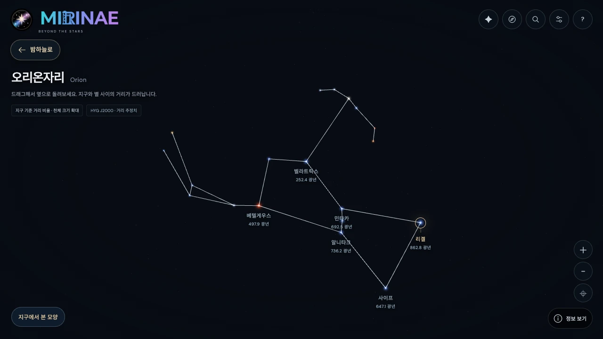
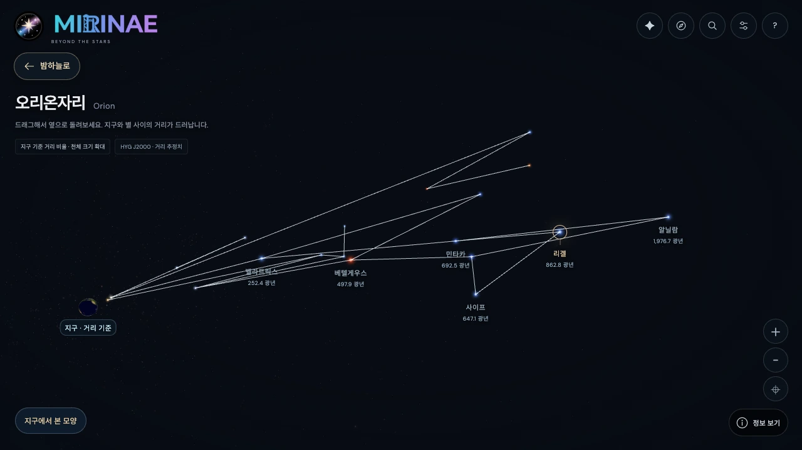

오리온자리에서 베텔게우스와 리겔은 어깨와 발을 잇는 한 그림의 일부처럼 보인다. 그 그림을 옆에서 보면 두 별은 얼마나 떨어져 있을까? 미리내(MIRINAE)는 관측 위치와 시각에 맞춘 밤하늘에서 출발해 별자리, 태양계, 심우주를 둘러보는 3D 웹 관측소다.

<!--truncate-->

## 지구에서 본 모양

밤하늘에서 오리온자리를 가리키고 ‘별자리 보기’를 열면, 지구에서 바라본 방향을 유지한 채 별자리 전체가 화면에 들어온다. 이 시점에서는 별을 잇는 선과 익숙한 윤곽을 따라가기 쉽다.

## 별자리의 옆모습

화면을 옆으로 드래그하면 별들이 한 평면에서 벗어난다. 화면에 표시된 HYG 별 목록의 추정치는 베텔게우스가 약 498광년, 리겔이 약 863광년이다. 정면에서는 한 별자리로 묶이던 두 점이 옆에서는 서로 다른 깊이에 놓인다.

공간 모형은 별까지의 거리 비율을 유지한다. 별 자체는 화면에서 찾을 수 있도록 크게 그렸고, 거리가 알려지지 않은 별은 모형에서 제외했다. ‘지구에서 본 모양’을 누르면 처음 윤곽으로 돌아간다. 두 시점을 오가면 별자리의 모양에 관측자의 위치가 어떤 역할을 하는지 볼 수 있다. [오리온자리 직접 돌려 보기](https://mirinaesky.com/?lang=ko#mode=depth&con=Ori) · [미리내 밤하늘 열기](https://mirinaesky.com/)
