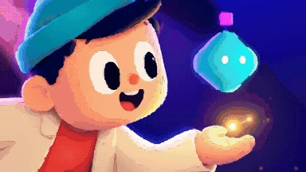

완성된 영상에서 제목 네 글자만 바꾸고 싶다면 어디를 눌러야 할까? 영상 파일에는 글자를 선택할 레이어가 없다. 새김은 로컬 영상의 프레임을 읽어 텍스트, 윤곽선, 그라디언트와 타이밍이 담긴 편집용 프로젝트를 만드는 도구다.

<!--truncate-->

## 8초를 193장으로 펼치기

예제로 사용한 *Dream Stage*는 직접 준비한 스타일 프레임 세 장으로 생성한 영상이다. 모자를 쓴 캐릭터가 작은 친구에게 손을 내밀고, 카메라가 물러나면 모니터와 무대가 드러난다. 마지막 2초에는 분석 전에 `DREAM STAGE`라는 제목을 영상에 입혔다. 입력에 이미 찍힌 글자가 결과물에서 다시 텍스트가 되는지 확인하기 위해서다.

640 × 360으로 준비한 영상에서 초당 24장, 총 193장을 관찰했다. 새김은 색이 나뉘는 경계를 도형으로 그리고, 한 도형 안에서도 밝기가 바뀌는 곳에는 그라디언트를 맞춘다. 결과를 HTML로 내보내면 브라우저가 SVG 요소를 그려 장면을 재생한다.

## 제목을 고치면 무엇이 따라 바뀔까

마지막 48프레임의 편집용 프로젝트에는 텍스트 하나와 패스 1,708개가 들어 있다. 편집기에서 제목을 선택해 `SAEGIM STUDIO`로 바꾸고 저장한 다음, 파일을 다시 열어 확인했다. 캐릭터의 이동 시점과 도형 순서는 그대로였고, 바꾼 제목이 같은 타이밍에 나타났다.

색을 바꾸는 실험에서는 다른 문제가 보였다. 청록색을 골라 주황색으로 옮기면 모자와 신발뿐 아니라 같은 색을 쓰는 무대 장식도 함께 바뀐다. 모자에만 조명이 비치게 하려면 어느 윤곽 안쪽이 모자에 해당하는지 프레임마다 지정해야 한다. 멀리서 뛰는 장면에서는 눈과 입의 가는 선도 일부 사라졌다. 홈의 비교 손잡이를 움직이면 원본의 부드러운 음영이 SVG에서 어떤 색면으로 나뉘는지 볼 수 있다.

전체 8초의 변환은 비교 영상에서 볼 수 있고, 마지막 2초는 파일을 내려받아 편집기에서 직접 고칠 수 있다. [원본 영상과 편집 가능한 예제](https://github.com/mooyeon-choi/saegim/tree/main/examples/rich-motion) · [새김 저장소](https://github.com/mooyeon-choi/saegim)
